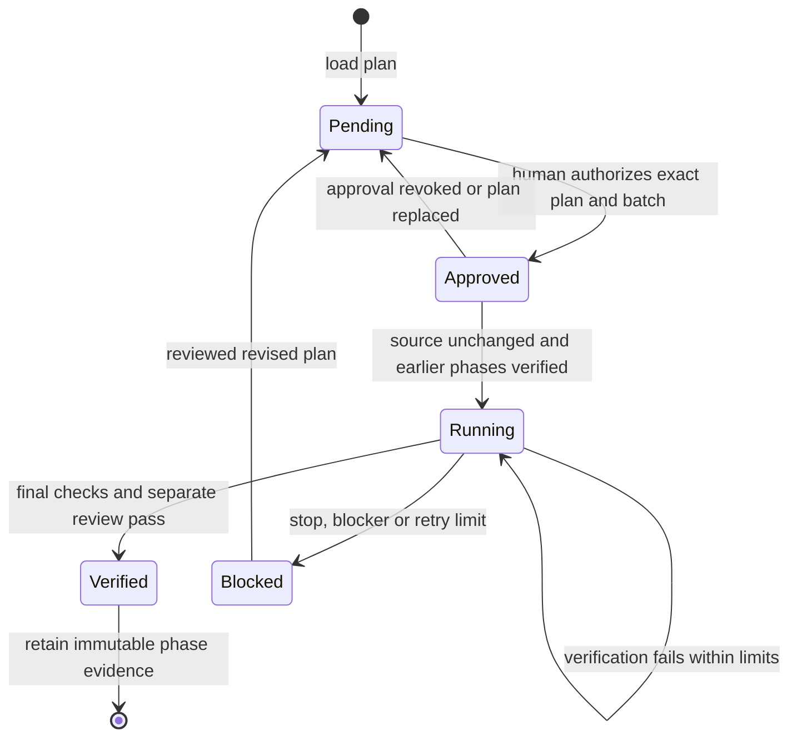

# Architecture and limits

The distribution has two components: host-readable coordinator/specialist instructions, and a deterministic Python ledger. The AI host performs semantic code review, edits, delegation and runtime investigation. The ledger validates data formats, stores per-project memory, binds approval to plan hash and project root, serializes its own operations, records test commands and enforces phase state transitions. It does not call any model API.

## State lifecycle

Budget exhaustion or scope refusal requires the coordinator to call stop and report partial work. The ledger cannot interrupt host tools. Verified earlier phases permit auto-continuation only when the next phase is already approved. A plan revision preserves the exact verified prefix, clears other approvals and establishes a reviewed new source baseline.

## Memory

.auditagent/state.json is authoritative local workflow data; SUMMARY.md is a short generated entry point; REPORT.md formats findings; inventory.json stores paths/detection, not source content. The coordinator adds project-map.md and coverage.md as compact audit context. Verification reports and check command metadata persist per phase. Detailed historical state need not be loaded into every agent context. A resume note stays in the generated summary after subsequent updates.

Memory is neither a vector database nor an LLM cache, and it does consume tokens when read. Source snapshots allow targeted reinspection; they cannot identify semantic impacts by themselves. Large state files accumulate across extensive use: archive completed audit runs privately after exporting decisions and start a new run deliberately, not by silently deleting approvals/history.

## Specialist strategy

Architecture, security, data, reliability, product, mobile, billing/AI and verification have native role definitions for both hosts. Select relevant roles, default at most three concurrent specialists, single delegation layer. The coordinator is the sole ledger writer. Only one implementation scope runs at a time. Use separate worktrees if different coding tools work concurrently; do not edit overlapping files.

## Approval model

Human chat approval may be faithfully recorded by the coordinator, or the human may run the approval CLI command. Both are local assertions. A strong organizational gate requires an external trusted approval service, OS-isolated write capability or CI-controlled merge/deployment. That infrastructure is not part of this release. No hooks alter global host policy or silently approve commands.

## Compatibility

The installer deploys a shared skill plus native role files to documented host paths without editing global host settings. The Claude marketplace package uses the standard plugin layout. Codex is supported through its skill/agent adapter, not an invented cross-host plugin format. Antigravity is usable as the IDE hosting either CLI; its own native agent is not separately integrated. Host command discovery/delegation depends on installed versions and permissions. If native roles unavailable, use supported generic subagents with the bundled role brief; if no separate reviewer exists, disclose and leave verification blocked.
